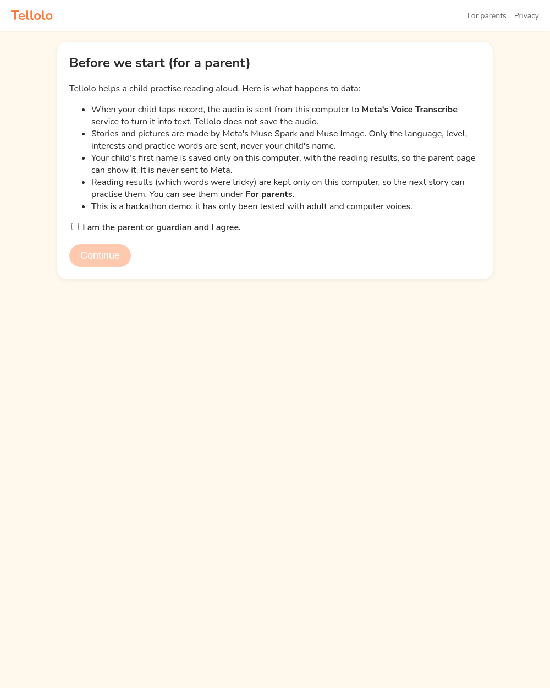
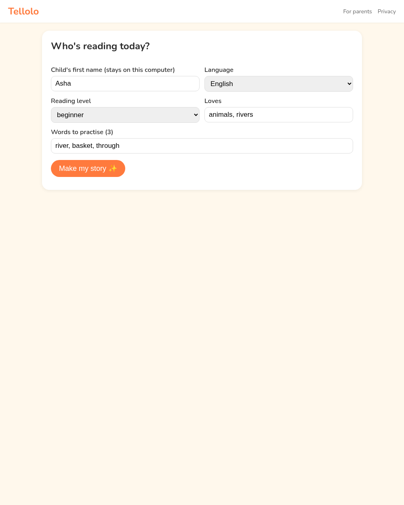
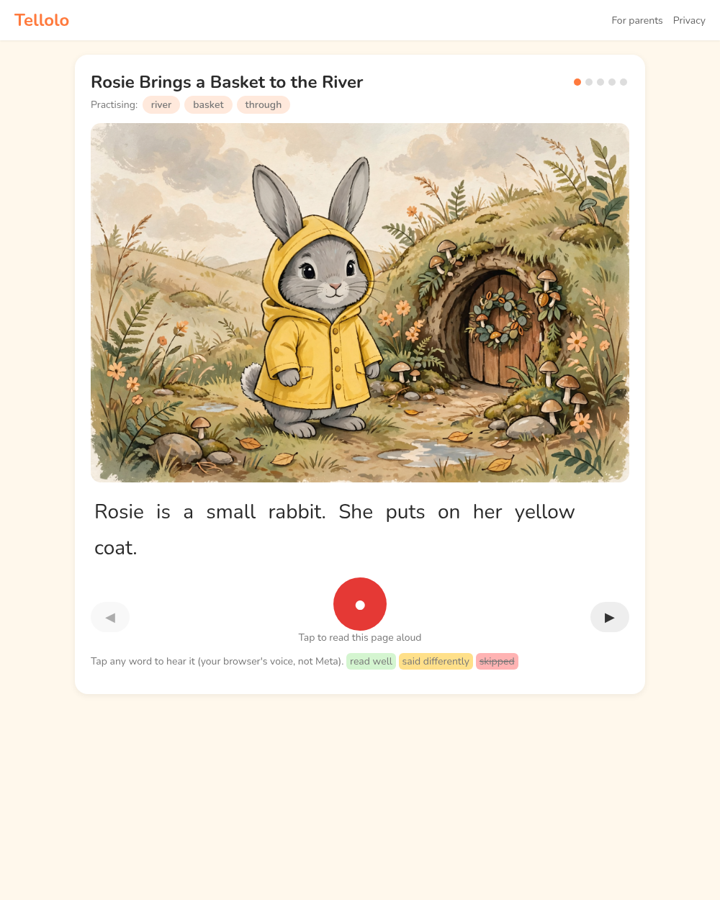
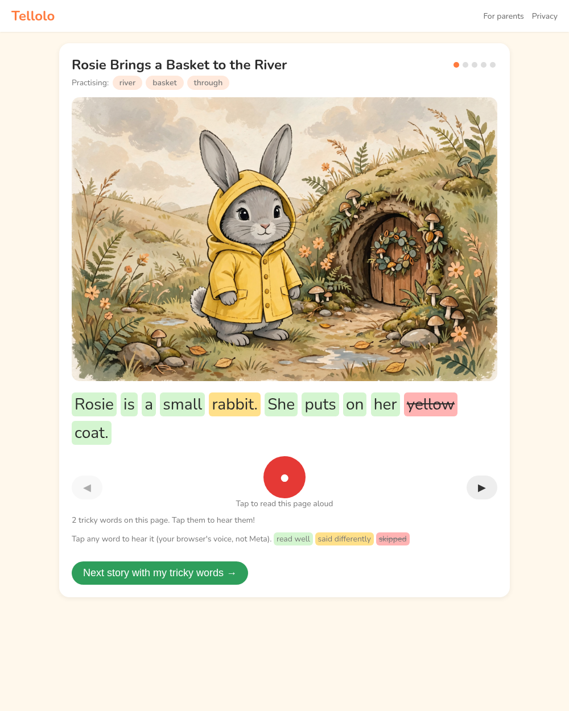
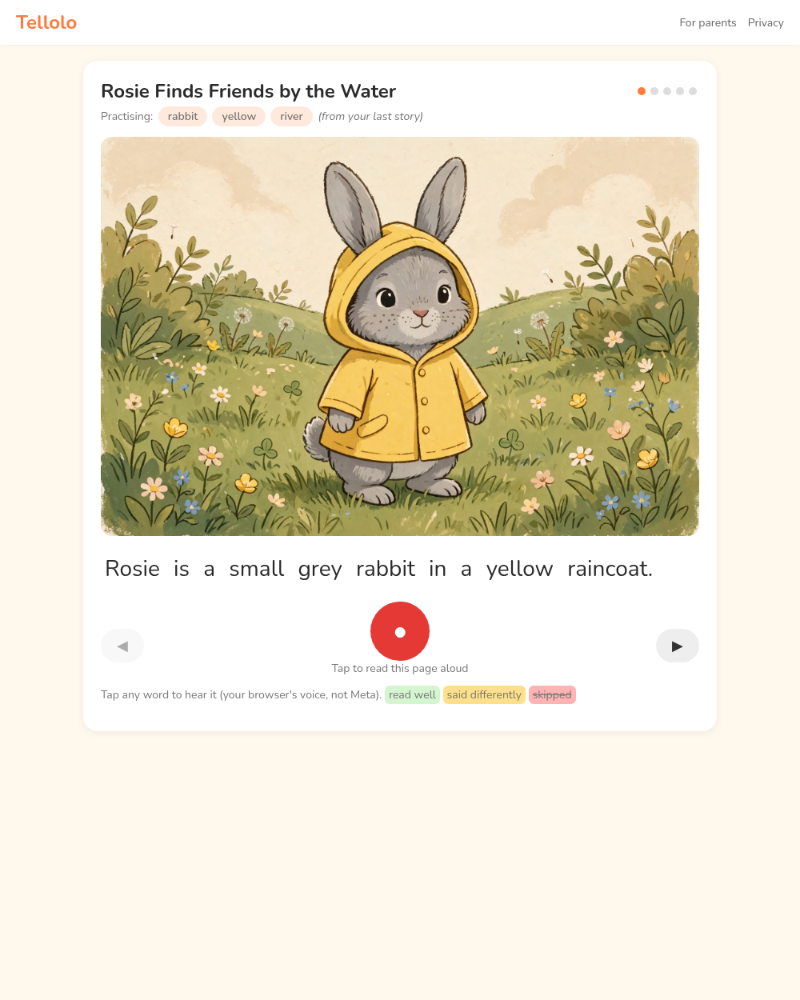
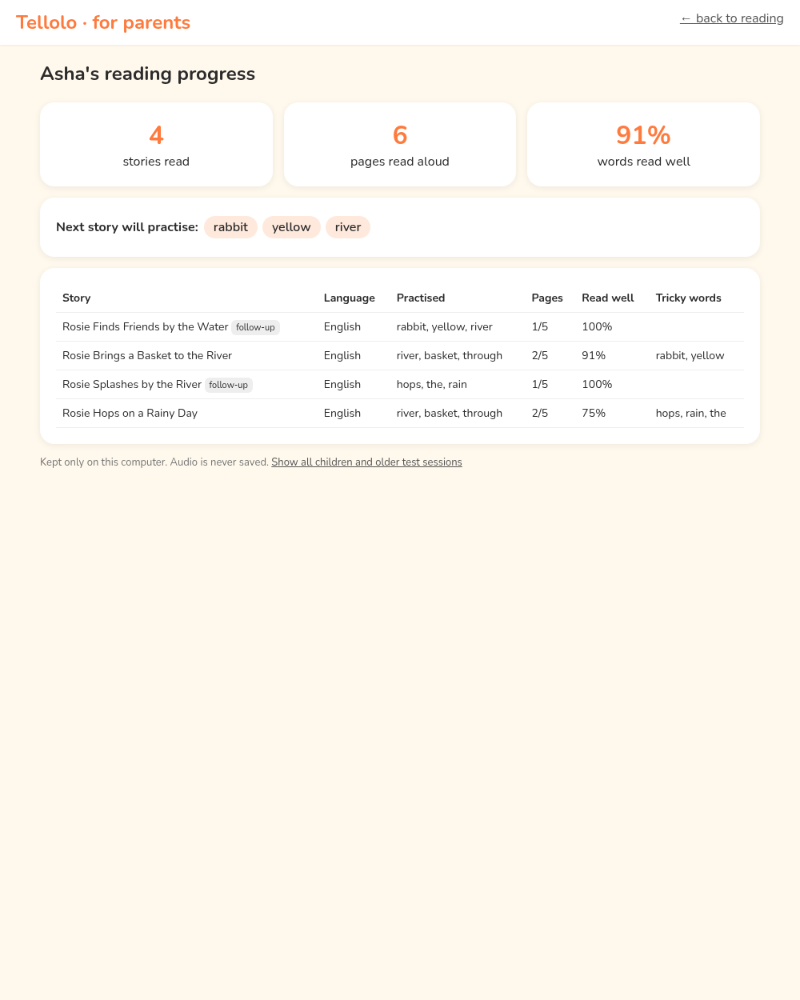
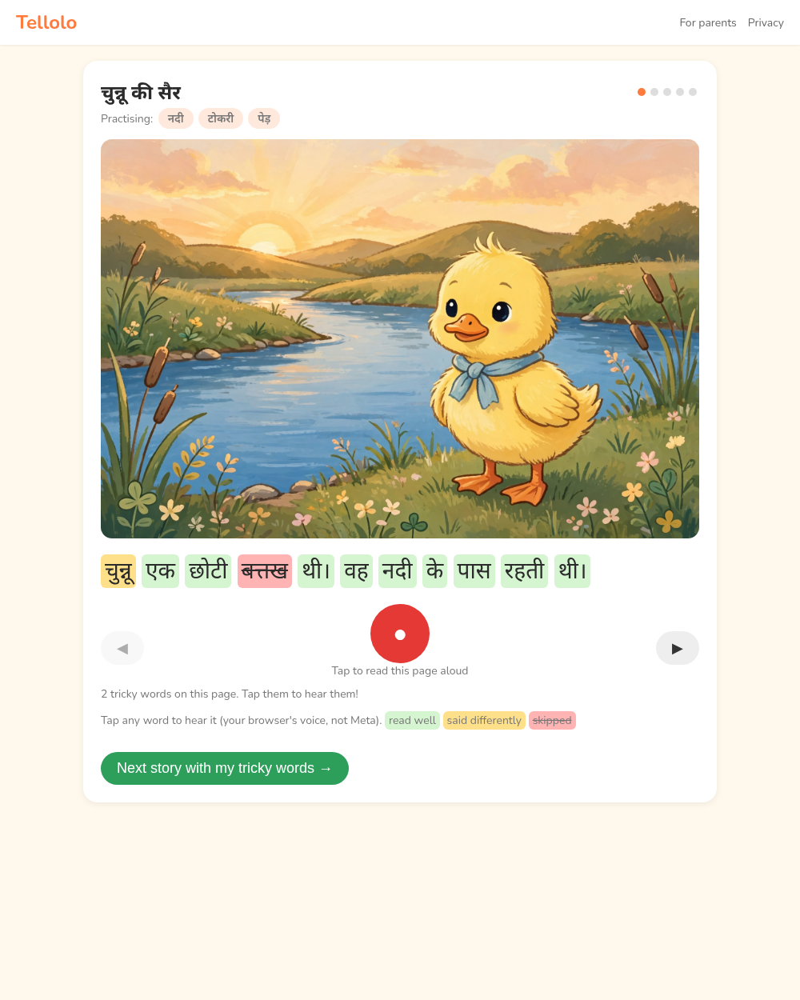
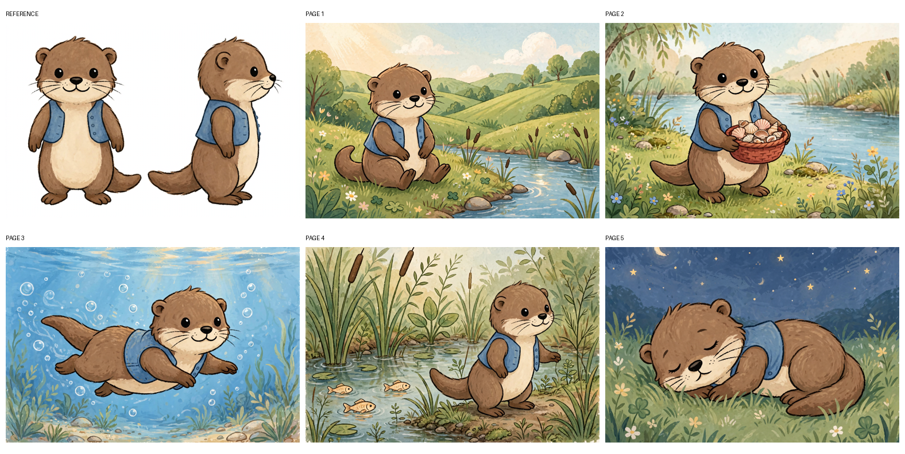

# Tellolo — kids' read-along in English and Hindi
Hackathon build for the Meta Global AI Developer Hackathon. All code was written Oct 27 2026 (IST) and later.
Muse Spark writes a 5-page story around the words a child finds hard. Muse Image draws it. The child reads each page aloud in the browser, Muse Voice Transcribe turns the reading into text on the server, and Tellolo marks each word as read well, said differently or skipped. Tricky words go into the next story, and parents see a per-child summary.

## How it works
1. **Consent** — a parent consent screen comes first.
2. **Profile** — language (English or Hindi), level, interests, practice ("trouble") words and a hero.
3. **Story** — Muse Spark (`muse-spark-1.3`) writes a 5-page story built around the trouble words.
4. **Pictures** — Muse Image (`muse-image-1.0`) draws page 1; that picture is the character reference for pages 2–5, drawn in parallel so the first page shows quickly.
5. **Read aloud** — the browser records each page; the server sends the audio to Meta Voice Transcribe (`muse-voice-transcribe-1.0`).
6. **Flags** — Tellolo's own word alignment (`align.py`) marks each of the story's own words as read well, said differently or skipped.
7. **Next story** — the missed words become the trouble words for the next story.
8. **Parent summary** — `/summary` shows progress per child.

## Architecture
- `app.py` — small Python HTTP server (stdlib) serving `static/` and the JSON API. The key stays on the server.
- `pipeline.py` — story, images, reading, next-words and summary logic; writes runtime output to `data/stories/` and names to `data/profiles.json` (never under `static/`).
- `align.py` — word alignment between the story text and the transcript (handles repeated words).
- `providers/` — swappable model layer: `meta.py` (Meta Model API, retries) and `mock.py` (offline, no key). Pick with `TELLOLO_PROVIDER=mock|meta`.
- `static/index.html`, `static/summary.html` — the child and parent UIs; `static/seed.json` — fixed fictional demo seed.
- `tests/` — end-to-end, retry and flow tests; `proof/*/SUMMARY.md` — results of each milestone run.
- `data/` is created and filled at runtime and is not in the repo. `static/` holds only the UI (`index.html`, `summary.html`, `common.js`, `app.js`, `summary.js`) and the fixed `seed.json` / `words.json`.

## Screenshots
| | |
|---|---|
|  |  |
|  |  |
|  |  |
|  |  |

## Setup
- Needs: Python 3.11+, `pip install requests pillow`, and `ffmpeg` on PATH. A modern Chrome, Edge or Firefox for the mic.
- Key: `export META_API_KEY=...` in the shell that runs the server. It is read only on the server, never sent to the browser and never written to a file. Don't commit it.
- Run without Meta (mock, no key): `./run.sh`, then open http://localhost:8010 ("DEMO MODE" badge).
- Run with Meta: `TELLOLO_PROVIDER=meta ./run.sh`
- **Recorded demo (one command):** `./demo.sh`, then open `http://localhost:8010/?demo=en` (Asha, English) or `?demo=hi` (Kabir, Hindi). Tick consent once and the story starts. On the profile screen, the same seeds are the "Asha · English" and "Kabir · हिन्दी" buttons. The seed is in `static/seed.json`: fixed profile, practice words and hero (Rosie the rabbit / मोती the puppy).

## Models used (Meta Model API, https://api.meta.ai/v1, verified with real calls)
| Step | Endpoint | Model |
|---|---|---|
| Story (JSON) | POST /chat/completions | muse-spark-1.3 |
| Page 1 picture (becomes the character reference) | POST /images/generations | muse-image-1.0 |
| Pages 2-5 (in parallel, page 1 passed as reference) | POST /images/edits | muse-image-1.0 |
| Reading → text | POST /asr/transcribe (PUSH_TO_TALK, languageBias) | muse-voice-transcribe-1.0 |
Not Meta: tap-to-hear uses the browser's own speech voice (labelled in the UI). Word marking is Tellolo's own alignment, because Voice Transcribe gives no word timings. Story and transcription calls retry 3 times with backoff on 429, 5xx and timeouts. Picture calls retry only when Meta surely did no work (429, or no connection), so a picture is never paid for twice; a page whose call may have been billed is left blank rather than asked again.

## Free credits
Built and tested on the hackathon's free Meta credits only. Rough cost per full demo run (2 stories, 10 pictures, 2–3 readings): about $0.10 at the published rates ($0.01 per image, $0.18 per audio hour, Spark per token). No paid services, no sign-ups.

## Privacy
- A parent consent screen comes first (the "Privacy" link reopens it).
- Audio (first 60 s of each recording) goes to Meta Voice Transcribe for transcription. Tellolo saves neither the audio nor the transcript; only the tricky words and error rate are kept.
- The child's first name is saved on the server running Tellolo (`data/profiles.json`, outside the web folder) so the parent page can show it; it is never sent to Meta. Meta only receives the language, level, interests, practice words and a demo hero.
- Runtime data lives in `data/` (or `TELLOLO_DATA`), never under `static/`: `data/stories/<id>/` (story, reading results, pictures), `data/profiles.json` (names), `data/budget.json` (today's Meta call count).
- The server issues every id (child, story and session; 128-bit random). A child belongs to the browser session that created it (signed, HttpOnly, SameSite=Strict cookie), and every read, rename, delete, picture and reading checks that. There is no "show all children" view.
- "Delete this child's data" on the parent page removes their stories, pictures, results and name; a story still being written is dropped and no more pictures are requested. `TELLOLO_KEEP_HOURS` (24 on Render) deletes anything untouched that long, checked every 15 minutes.
- Tested only with adult and synthetic voices (espeak-ng, gTTS, LibriSpeech CC BY 4.0). No children's data was used. Real use with children needs verifiable parental consent (India DPDP Act 2023).

## Tests and proof
Offline (no key, no Meta calls, needs ffmpeg): `python3 tests/security_test.py`, `python3 tests/unit_test.py`, `python3 tests/retry_test.py`.
The M1–M3 proof scripts (`e2e`, `m2_flow`, `m3*_flow`, `human_voice`, `browser`) need real Meta calls and/or Playwright; the browser ones predate sessions and the word lists and need updating before they run again.
Full screenshots and recordings from the proof runs are kept out of the repo; `proof/*/SUMMARY.md` and the JSON results are included. `tests/` (e2e, retry, m2_flow, human_voice, m3_flow, m3fix_flow) write to `proof/m1..m3fix/`. Credits: `samples/librispeech/` is LibriSpeech (Panayotov et al., openslr.org/12), CC BY 4.0.

## Licence
TBD: no licence chosen yet (Hari to decide before any public repo). Until then, all rights reserved.

## Known gaps
Not tested on a real microphone or real device. Tap-to-hear sound not verified. Short clipped words at the end of a recording are sometimes heard wrong. Spark Open not used (no credits).

## Deploy on Render
Hosted, Tellolo refuses all API calls until `TELLOLO_PASSCODE` and `TELLOLO_SECRET` are set, and `/healthz` reports why it isn't ready (missing key, passcode, secret or ffmpeg). Testers enter the passcode once per browser (5 wrong tries per IP per 15 minutes). Limits: 8 stories per session and 20 per IP per hour, 60/150 readings, at most 32 requests and 2 ffmpeg conversions at once, and `TELLOLO_DAILY_META_CALLS` Meta calls per day. Also set a spending limit in your Meta account.

1. On Render, choose **New → Blueprint** and pick this repo; `render.yaml` builds the `Dockerfile` (Python 3.13.5 + Debian ffmpeg) as a free web service. A service created earlier with the native Python runtime can't switch to Docker in place: create a new one from the blueprint and delete the old one.
2. Set `META_API_KEY` and `TELLOLO_PASSCODE` as secrets when prompted (never commit them). Render generates `TELLOLO_SECRET`. `TELLOLO_PROVIDER=meta` is preset.
3. Rate limits use the client address from `X-Forwarded-For` (`TELLOLO_PROXY_HOPS`, default 1 = the entry Render's proxy added).
4. The free plan's disk is ephemeral: `data/` (stories, names and the Meta call counter) resets on each redeploy or spin-down. The counter survives process restarts on a persistent disk (mount one at `data/` on a paid plan); otherwise rely on Meta's own spending limit as the hard stop.
