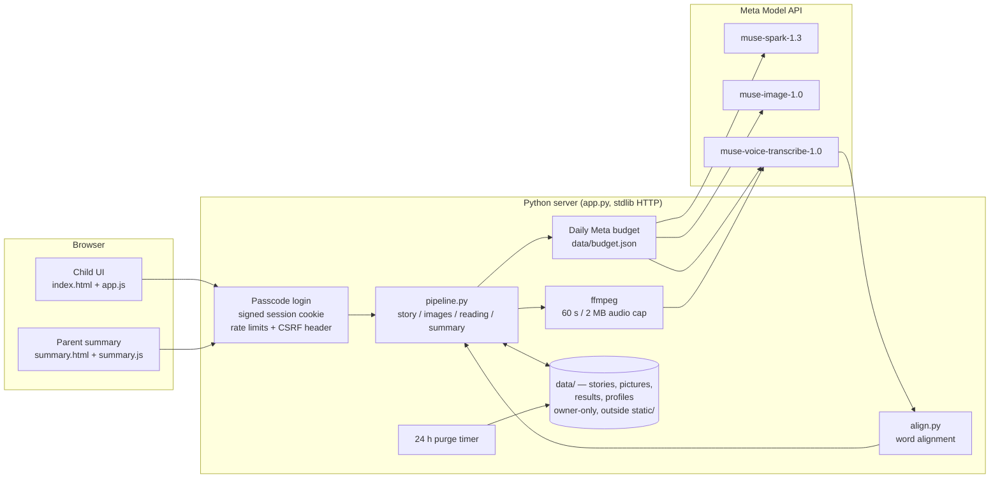

# Tellolo — a read-along tutor for kids, in English and Hindi, on Meta models

Built for the **Meta Global AI Developer Hackathon** (Oct 26 – Nov 5, 2026). All code in this repo was written during the hackathon, from Oct 27, 2026 onward (see the timeline below).

## The problem
Children learning to read need someone to listen to them read aloud and notice which words they stumble on, then practise exactly those words. Most kids don't get that one-on-one listening every day, and in India many are learning to read in both English and Hindi. Tellolo listens to a child read a story built around their own hard words, marks each word as read well, said differently or skipped, and writes the next story around the words they missed. Parents get a simple per-child summary.

## How it uses Meta models
All three are called through the Meta Model API (`https://api.meta.ai/v1`), only from the server.

| Model | Endpoint | What Tellolo does with it |
|---|---|---|
| **muse-spark-1.3** | `POST /chat/completions` | Writes a 5-page story as structured JSON, in English or Hindi, at the child's level, around their interests, a fixed demo hero and their practice ("trouble") words. |
| **muse-image-1.0** | `POST /images/generations`, `POST /images/edits` | Draws page 1; that picture is then passed as the character reference for pages 2–5, which are drawn in parallel so the hero stays consistent and page 1 appears fast. |
| **muse-voice-transcribe-1.0** | `POST /asr/transcribe` (push-to-talk, language bias) | Turns the child's recorded reading of each page into text. Tellolo's own aligner (`align.py`) compares it with the page text word by word, since the API returns no word timings. |

The loop is closed: words the child missed become the trouble words for the next Spark story. Not Meta: "tap to hear" uses the browser's built-in speech voice (labelled in the UI).

## Architecture


- `app.py` — HTTP server, session/passcode gate, rate limits, owner-only file serving, purge timer.
- `pipeline.py` — story, images, reading, next-words and summary logic.
- `align.py` — alignment between the story text and the transcript (handles repeated words).
- `providers/` — swappable model layer: `meta.py` (Meta Model API, budget, retry policy) and `mock.py` (offline, no key). Chosen with `TELLOLO_PROVIDER=mock|meta`.
- `static/` — UI only (`index.html`, `summary.html`, `common.js`, `app.js`, `summary.js`, `seed.json`, `words.json`).

## Screenshots
| | |
|---|---|
|  |  |
|  |  |
|  |  |
|  |  |

## Safety and privacy design
Built for children, so the hosted demo is locked down:
- **Passcode session.** When hosted, every API call needs a session unlocked once with `TELLOLO_PASSCODE` via `/api/login` (5 wrong tries per IP per 15 min). Sessions are signed (`TELLOLO_SECRET`), HttpOnly, SameSite=Strict, Secure when hosted. Every API call also needs an `X-Tellolo` header to block cross-site requests. Hosted, the app refuses API calls until the passcode and secret are set.
- **Budget and limits.** A daily cap on Meta calls (`TELLOLO_DAILY_META_CALLS`) checked before any paid call (including before audio conversion) and kept in `data/budget.json`; if the file can't be read, calls are refused. Per-session and per-IP hourly limits (8/20 stories, 60/150 readings, 10/30 new children), at most 32 request threads and 2 ffmpeg runs at once. Audio is capped at 60 s / 2 MB with a fixed ffmpeg input whitelist.
- **No double billing.** Picture calls retry only when Meta certainly did no work (429 or no connection); a page whose call may have been billed is left blank, never requested again.
- **Allow-lists, no free text into prompts.** Interests and practice words come only from `static/words.json` (pick lists). Next-story words come from the child's own last story and must be plain letters. Model-written text is stripped to letters, digits and basic punctuation before going into an image prompt. All model output is rendered with `textContent` (no `innerHTML`), and the CSP allows only same-site scripts.
- **Owner-only data.** The server issues every id (child, story, session; 128-bit random). A child belongs to the session that created it, and every read, rename, delete, picture and reading checks ownership. Runtime data lives in `data/`, never under `static/`. There is no "all children" view.
- **Delete and 24 h purge.** "Delete this child's data" removes stories, pictures, results and name, and cancels a story still being written. Anything untouched for `TELLOLO_KEEP_HOURS` (24 on Render) is deleted by a timer every 15 minutes.
- **What Meta sees.** Audio (first 60 s of each recording) goes to Voice Transcribe; Tellolo keeps neither audio nor transcript, only tricky words and error rate. The child's first name stays on the server and is never sent to Meta.
- **No children's data used.** Tested only with adult and synthetic voices (espeak-ng, gTTS, LibriSpeech CC BY 4.0). Real use with children needs verifiable parental consent (e.g. India's DPDP Act 2023).

## Run it locally
Needs Python 3.11+, `pip install -r requirements.txt`, and `ffmpeg` on PATH; a modern Chrome, Edge or Firefox for the mic.

- **Mock provider (no key, no Meta calls):** `./run.sh`, open http://localhost:8010 ("DEMO MODE" badge).
- **Recorded demo seed:** `./demo.sh`, then `http://localhost:8010/?demo=en` (Asha, English) or `?demo=hi` (Kabir, Hindi). Seeds are fictional (`static/seed.json`).
- **Real Meta:** set `META_API_KEY` in your shell (never commit it), then `TELLOLO_PROVIDER=meta ./run.sh`.
- **Docker** (Python 3.13.5 slim + Debian ffmpeg, non-root):
  `docker build -t tellolo .` then `docker run -p 8010:8010 -e PORT=8010 -e TELLOLO_PROVIDER=mock tellolo` (setting `PORT` makes the app bind `0.0.0.0`).

**Environment variables (names only):**
`META_API_KEY`, `TELLOLO_PROVIDER`, `TELLOLO_PASSCODE`, `TELLOLO_SECRET`, `TELLOLO_DAILY_META_CALLS`, `TELLOLO_KEEP_HOURS`, `TELLOLO_PURGE_EVERY`, `TELLOLO_DATA`, `TELLOLO_MAX_THREADS`, `TELLOLO_FFMPEG_MAX`, `TELLOLO_PROXY_HOPS`, `TELLOLO_LOG_PROMPTS`, `HOST`, `PORT`, `META_API_BASE`, `META_TEXT_MODEL`, `META_IMAGE_MODEL`, `META_ASR_MODEL`, `META_TIMEOUT`, `META_RETRIES`, `META_BACKOFF`; mock-only: `MOCK_READ_ERRORS`, `MOCK_IMAGE_DELAY`.

**Deploy on Render:** New → Blueprint on this repo; `render.yaml` builds the `Dockerfile`. Set `META_API_KEY` and `TELLOLO_PASSCODE` as secrets; Render generates `TELLOLO_SECRET`. The free plan's disk is ephemeral, so the call counter resets on redeploy: also set a spending limit in your Meta account.

## Tests
Offline (no key, no Meta calls; needs ffmpeg):
```
python3 tests/unit_test.py      # in-process, stub providers
python3 tests/security_test.py  # HTTP security suite against real server processes
python3 tests/retry_test.py     # retry policy and no-double-billing
```
All three pass on commit `9dbd730`. The milestone proof scripts (`e2e`, `m2_flow`, `m3*_flow`, `human_voice`, `browser`) need real Meta calls and/or Playwright; the browser ones predate sessions and word lists and need updating. Their results are in `proof/*/SUMMARY.md` and JSON files.

## Built during the hackathon (from git log)
| Date (IST) | Commit | What |
|---|---|---|
| Oct 27, 2026 | `5559545` | Tellolo: read-along in English and Hindi on Meta models (story, pictures, transcription, alignment, parent summary) |
| Oct 29, 2026 | `924a394`, `1f4916f`, `b7a5420` | Render deploy, requirements, `/healthz` |
| Oct 31, 2026 | `1d6eb08` | Hardening: passcode, Meta budget, per-child data, privacy |
| Oct 31, 2026 | `9dbd730` | Second hardening: sessions, data out of `static/`, limits, no double billing, Docker |
| Nov 2, 2026 | this commit | Judge-ready README |

## Limitations
- Not tested on a real microphone, real device, or with real children. Tap-to-hear sound not verified.
- Short clipped words at the end of a recording are sometimes heard wrong.
- On Render's free plan the daily call counter resets on redeploy or spin-down; Meta's own spending limit is the real hard stop.
- Consent is recorded only in the browser; the 24 h deletion runs on a timer and isn't guaranteed if the service is down; a rename at the same moment as a delete can recreate a profile; the passcode lockout can be raced with many parallel tries. Fine for a passcode-gated demo, not for a wide public link.
- Story and transcription retries can bill twice (only pictures are protected).
- Rate limits assume one proxy hop (`TELLOLO_PROXY_HOPS=1`).
- Spark Open / open-weight models not used.

## Credits and licence
`samples/librispeech/` is LibriSpeech (Panayotov et al., openslr.org/12), CC BY 4.0, adult LibriVox readers.

**Licence: none yet.** No licence file is included; until one is added, all rights are reserved. To be decided by the author before or when the repo goes public.
